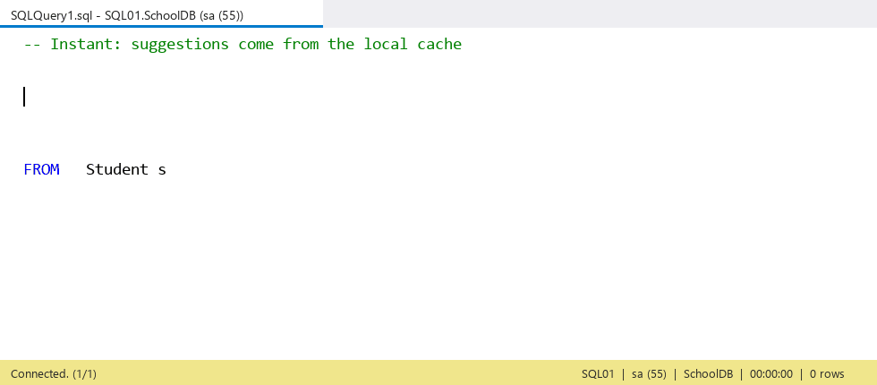

# SSMS Schema IntelliSense

**Instant table, column and function suggestions in SQL Server Management Studio — without waiting for IntelliSense to load.**



SSMS rebuilds its IntelliSense cache every time you open a query window, and on large databases or remote
servers that often means a long wait, or no suggestions at all. This extension saves each database's schema
**to your disk** the first time you use it. After that, suggestions appear the moment you start typing —
even right after SSMS starts, and even when the server is slow.

- ⚡ **Instant** — suggestions come from a local file, not from the server.
- 🎯 **Follows the active query window** — the current server and database, including the database dropdown and `USE`.
- 🔄 **Stays current** — refreshed quietly in the background, at most every 30 minutes, with one lightweight query.
- 🧩 **Works across SSMS versions** — one installer for SSMS 18, 19, 20, 21 and 22.
- 🧮 **Built-in functions too** — about 150 T-SQL functions and `@@` variables, each with its parameters.
- 🔔 **Updates itself** — checks GitHub once a day and offers new versions with one click.
- 🪶 **Lightweight** — a single ~185 KB installer, nothing else to install.

## What it suggests

| You type | You get |
|---|---|
| `SELECT * FROM Stu` | tables, views, procedures, functions and synonyms whose name matches |
| `SELECT s.` … `FROM Student s` | the columns of `Student`, with their data types |
| `Student.` | the columns of `Student` |
| `sales.` (a schema name) | the objects in the `sales` schema |
| a plain word inside a query | the columns of every table in the `FROM` / `JOIN` of that query first, then all objects, then built-in functions |
| `getd` | `GETDATE()` and other built-in functions, with their parameters and the SQL Server version they need |
| `@@ro` | `@@ROWCOUNT` and the other `@@` system variables |
| `FROM STRING_` | table-valued functions such as `STRING_SPLIT`, `OPENJSON`, `GENERATE_SERIES` |

The list narrows as you type. **Tab** or **Enter** inserts the highlighted suggestion, **Esc** closes the
list, and typing `.` after a table or alias opens its columns. After `FROM`, `JOIN`, `UPDATE`, `INTO` or
`EXEC` only tables, views, procedures and functions are offered, never columns. Functions that take no
arguments insert their brackets: `getd` + Tab gives `GETDATE()`.

## Requirements

- Windows 10 or 11
- SQL Server Management Studio **18, 19, 20, 21 or 22**
- .NET Framework 4.7.2 or later (already part of Windows 10 / 11)
- Administrator rights to install (SSMS is under *Program Files*)

## Install

1. Download **`SsmsSchemaIntelliSense-Setup.exe`** from the [latest release](../../releases/latest).
2. Double-click it and click **Yes** when Windows asks for permission.
   - Windows may first show *"Windows protected your PC"* because the EXE is not code-signed:
     click **More info → Run anyway**.
3. The setup window shows each step. If SSMS is open it asks you to save your queries and close it, then
   continues **by itself** as soon as SSMS is closed.
4. Click **Open SSMS**, connect a query window to a database, and start typing.

Setup finds every SSMS 18–22 on the PC and installs the right build into each one.

> **Tip:** if SSMS's own suggestion list also appears, switch it off in
> **Tools → Options → Text Editor → Transact-SQL → IntelliSense → Enable IntelliSense**.

The first time you use a database, its schema is fetched once (a few seconds on a database with thousands of
objects). Every time after that, suggestions are instant.

## Updates

The extension checks this repository's latest release **once a day** in the background. When a newer
version exists, a window shows what's new and offers three choices: **Update now**, **Remind me tomorrow**
or **Skip this version**.

**Update now** walks you through every step in the same window:

1. **Download the update** — with a progress bar.
2. **Check that the download is genuine** — its SHA-256 must match the checksum GitHub publishes for the file.
   A file that doesn't match is deleted, never run.
3. **Start the installer** — Windows asks for permission: click **Yes**.
4. **Close SSMS** — the setup window then finishes the update by itself and tells you when it's done.

Your saved schemas are kept. The installer is only ever downloaded from
`github.com/gulshankundnani/SsmsSchemaIntelliSense`. To turn the daily check off, set
`AutoUpdateCheck=false` in `%LOCALAPPDATA%\SsmsSchemaIntelliSense\settings.txt`.

**Updating by hand** (and from 1.0.0 or 1.1.0, which have no update check): download the new EXE from the
[latest release](../../releases/latest) and run it.

## Uninstall

Run from a command prompt:

```
SsmsSchemaIntelliSense-Setup.exe /uninstall
```

The setup window asks you to close SSMS if it's open, then removes the extension. To also delete the saved
schemas, remove the folder `%LOCALAPPDATA%\SsmsSchemaIntelliSense`.

Setup options: `/uninstall` removes the extension; `/quiet` installs (or removes, with `/uninstall`) with no
window at all, for scripted installs, and fails with exit code 3 if SSMS is open.

## Privacy and security

- **Stored on your PC only:** object names, column names and data types, one file per server + database, in
  `%LOCALAPPDATA%\SsmsSchemaIntelliSense\cache`. **No table data and no passwords are ever saved.**
- **Sent to your server:** one read-only catalogue query (`sys.objects`, `sys.schemas`, `sys.columns`) per
  database, at most every 30 minutes. It runs on its own connection, so it never touches your query window's
  session or transactions.
- **Credentials:** the extension uses the login of the query window you are typing in, only in memory, to run
  that query. Your credentials, queries and schema never leave your PC.
- **Internet:** once a day it asks GitHub for this project's latest release (a plain HTTPS request with no data
  about you or your databases; GitHub sees your IP address as with any website). Turn it off with
  `AutoUpdateCheck=false` in `settings.txt` (see [Updates](#updates)). There is no telemetry.

## Troubleshooting

Everything the extension does is written to **`%LOCALAPPDATA%\SsmsSchemaIntelliSense\log.txt`**: which
server and database it detected, each schema refresh (object count and time taken), and any error.

| Symptom | What to check |
|---|---|
| No suggestions at all | Is the query window connected? Look in `log.txt` for "Active window ->". |
| Two suggestion lists | Turn off SSMS's own IntelliSense (see the tip above). |
| A new table or column is missing | The schema refreshes at most every 30 minutes; restart SSMS to refresh sooner. |
| Nothing in the log after installing | Restart SSMS; if still nothing, close SSMS and run the installer again. |
| No update offer behind a company proxy | The check uses Windows' proxy settings; `log.txt` shows "Update check failed" with the reason. Update by hand from Releases. |

## Limitations

- **Microsoft Entra ID (Azure AD) interactive / MFA** connections can't refresh in the background; they use
  the schema saved from an earlier connection with Windows or SQL Server login.
- Query parsing is deliberately simple: aliases from `FROM`, `JOIN`, `UPDATE`, `INTO`, `APPLY` and `MERGE`
  are recognised; CTE and derived-table aliases are not.
- The built-in function list is fixed and shows every function regardless of your server's version: for
  example `GREATEST` (SQL Server 2022+) is offered on older servers too. The tooltip shows the minimum version.
- Tested on **SSMS 22**. SSMS 18–21 are supported by design but not yet confirmed on real installs —
  feedback welcome.

## How it works

- On a keystroke in a SQL query window, the extension reads which server and database that window is
  connected to, and loads that database's saved schema from disk.
- The first time you use a database after SSMS starts, and at most every 30 minutes after that, the saved
  schema is refreshed in the background with one read-only catalogue query; your typing never waits for it.
- Built-in T-SQL functions and `@@` variables come from a list inside the extension, so they need no server
  query at all.
- It adds a small keyboard handler to each SQL window, because SSMS's own SQL editor would otherwise swallow the
  keystrokes that narrow the list.
- One installer covers SSMS 18–22: it detects each SSMS's editor engine and installs the matching build.

## Version history

| Version | Changes |
|---|---|
| **1.3.0** | Update window inside SSMS with release notes and a step-by-step checklist (download, verify, permission, close SSMS); setup is now a window instead of a console and continues by itself once SSMS is closed, with an **Open SSMS** button at the end. |
| **1.2.0** | Daily update check against this repository's releases, one-click download with SHA-256 verification, installer finishes after SSMS closes; `settings.txt` to turn it off. |
| **1.1.0** | About 150 built-in T-SQL functions and `@@` variables with their parameters; table-valued functions (`STRING_SPLIT`, `OPENJSON`, `GENERATE_SERIES`) after `FROM` / `JOIN`; only tables, views and functions after `FROM` / `JOIN` (Tab no longer inserts a column there); no-argument functions insert their `()`. |
| **1.0.0** | First release: local schema cache per server + database, column suggestions by alias or table, objects by schema, background refresh, one installer for SSMS 18–22. |

## ☕ Support this project

SSMS Schema IntelliSense is **free to use**. If it saves you time every day, a small donation keeps it
maintained and helps add support for more SSMS versions. Any amount is appreciated.

**UPI (India):** `gulshankundnani@okaxis`

Scan with any UPI app (Google Pay, PhonePe, Paytm, BHIM):


Bug reports and feedback are just as welcome — open an [issue](../../issues).

## Author

Gulshan Kundnani
